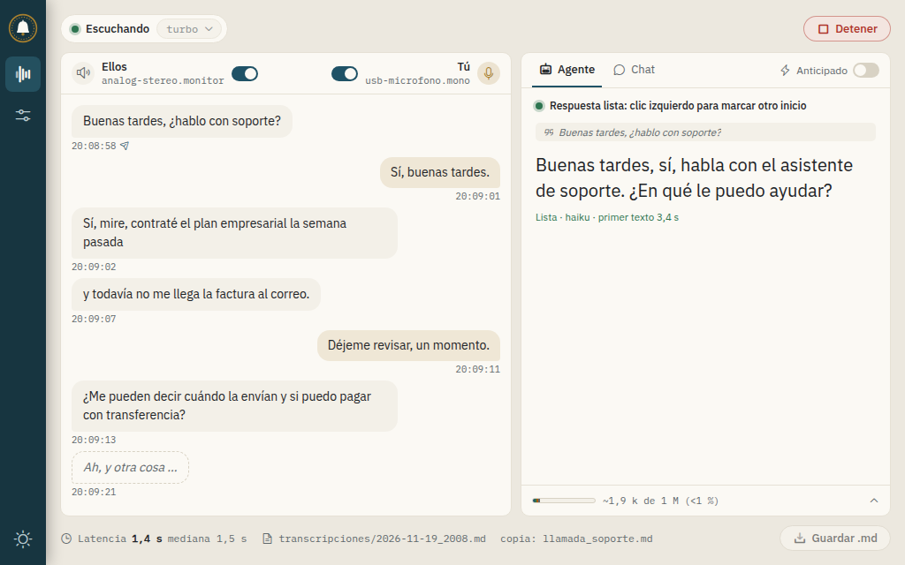

<p align="center">
  <picture>
    <source media="(prefers-color-scheme: dark)" srcset="docs/logo-dark.png">
    
  </picture>
</p>

# IvyBells

[](https://github.com/TheShimmyXD/IvyBells/actions/workflows/ci.yml)

Transcribe en vivo, en la GPU de tu equipo y sin mandar el audio a ninguna nube,
lo que suena por los parlantes o audífonos y lo que dices por el micrófono, con
**«Ellos»** y **«Tú»** separados. Sirve para llamadas de Meet, Teams o cualquier
otra app: escucha la salida de audio del sistema, no la app.

<picture>
  <source media="(prefers-color-scheme: dark)" srcset="docs/captura-dark.png">
  
</picture>

*Llamada de ejemplo (la demo de la interfaz); la latencia del pie es la mediana
medida en uso real.*

La ventana (Tauri, con la interfaz en React) tiene dos módulos sobre la misma
escucha:

- **En vivo:** las dos columnas, «Ellos» y «Tú», con frases provisionales que
  se confirman al terminar cada frase; en la cabecera de cada canal se elige el
  equipo, y un clic en su icono lo cierra o lo abre. Al lado, el panel del
  Agente:
  - **Agente:** marcas un tramo de la conversación (clic izquierdo al inicio,
    derecho al final) y Claude Code propone qué responder según un perfil
    (quién eres y qué buscas en la llamada) y el contexto de tu empresa (PDF,
    Word o Markdown). En modo **Anticipado** responde en cuanto la otra persona
    termina de hablar. Una barra muestra cuánto ocupa cada parte del contexto.
  - **Chat:** una conversación tuya con Claude que ve las dos columnas, con su
    propio modelo y esfuerzo.
- **Configuración:** pestañas **Claude** (cuenta, modelo, esfuerzo, respaldo y
  tiempo máximo), **Perfil del agente** y **Contexto** (cuánto pesa cada
  archivo).

## Cifras medidas

En una GTX 1660 Super (6 GB), con `large-v3-turbo` en `int8`. La latencia es
de una llamada real (2026-11-19, 125 frases de «Ellos»); el resto, del banco del
2026-10-17 en `bench/resultados/`:

| Medida | Valor |
|---|---|
| Latencia en vivo (desde que termina la frase hasta su texto) | mediana 1,5 s, p90 2,4 s |
| Velocidad (RTF, menor es mejor) | 0,044: 60 s de audio en 2,6 s |
| VRAM del motor | 1340 MiB |
| Carga del modelo | 2,9 s |

## Qué no toca

- El audio no sale del equipo: la transcripción corre en tu GPU con
  faster-whisper. Solo el módulo Agente manda **texto** (la transcripción, el
  perfil y el contexto) a Claude, con tu propia sesión de Claude Code.
- No cambia la salida ni la entrada predeterminadas del sistema y no toca la
  configuración de PipeWire: solo lee las fuentes con `pactl` y `parec`.
- No usa `sudo` ni instala CUDA Toolkit: cuBLAS y cuDNN llegan por `pip` dentro
  de `.venv/`.
- Lo suyo queda en esta carpeta (`resources/json/`, `logs/`,
  `transcripciones/`), la sesión de Claude de cada cuenta en
  `~/.local/share/ivybells/` y el modelo de Whisper en `~/.cache/huggingface/`.
  Tus perfiles y contextos no se versionan.

## Requisitos

- Linux con PipeWire (probado en Ubuntu 26.04 con PipeWire 1.6.2) y
  `pactl`/`parec` (paquete `pulseaudio-utils`).
- Una GPU NVIDIA con su driver.
- Python 3.13 o superior con `venv` (en Debian/Ubuntu/Mint: `python3-venv`).
- Para el módulo Agente, la CLI de [Claude Code](https://claude.com/claude-code)
  con una sesión iniciada. La transcripción funciona sin ella.
- Para la ventana: Node (npm) y Rust (cargo), los dos sin sudo (nvm y rustup),
  y `webkit2gtk-4.1` (`libwebkit2gtk-4.1-dev`).

## Instalación

```bash
git clone https://github.com/TheShimmyXD/IvyBells.git
cd IvyBells
./install.sh
```

`install.sh` crea `.venv/` dentro de la carpeta, instala las dependencias,
compila la ventana de Tauri (unos 80 s la primera vez) y deja IvyBells en el
menú de aplicaciones. La primera vez que transcribe descarga el modelo (1,6 GB).

### Instalar en otra máquina

El repositorio trae todo lo que necesita: la API local de la ventana y el crate de
Tauri vienen de `jacck_common`, una librería propia del autor que no se publica, y
van copiados en `vendor/jacck_common/`. En otra máquina basta con el `git clone` y
`./install.sh` de arriba (135 s en un clon limpio, 75 s de ellos compilando la
ventana). Allí `install.sh` copia la ventana (12 MB) a `desktop/bin/` y borra la
compilación (`desktop/src-tauri/target/`, 1,2 GB) y `web/node_modules/` (194 MB):
la carpeta queda en 2,7 GB, casi todo el `.venv`. Para desarrollar o recompilar,
`cd web && npm ci`; si hay una compilación nueva, se abre esa y no la copia.

En la máquina del autor, si `../jacck_common` está al lado, `install.sh` usa esa
copia (editable) y la carpeta de compilación compartida. Tras cambiar algo allí:

```bash
python3 vendor/sync_jacck_common.py          # trae los cambios a vendor/
python3 vendor/sync_jacck_common.py --check  # sale 1 si difieren
```

Para abrirlo sin el menú:

```bash
.venv/bin/python main.py        # ventana de Tauri
.venv/bin/python main.py --cli  # transcripción en la consola
```

## Primer uso

1. Mira que IvyBells vea tus fuentes de audio:
   ```bash
   .venv/bin/python main.py --fuentes
   ```
   Debe salir una fuente `.monitor` (lo que suena) y tu micrófono.
2. Abre la ventana, elige el modelo y pulsa **Iniciar**. «Ellos» es lo que
   suena por los parlantes; «Tú», el micrófono.
3. Para el Agente, en **Configuración** elige la cuenta de Claude, crea un
   perfil (hay uno de ejemplo en `resources/agent/perfiles/ejemplo.md`) y
   agrega las rutas del contexto de tu empresa.

En una llamada real, avisa a los demás participantes de que la estás
transcribiendo.

### En la consola

```bash
.venv/bin/python main.py --cli                 # large-v3-turbo int8
.venv/bin/python main.py --cli --model small   # otro modelo de faster-whisper
```

La transcripción queda en `transcripciones/` como `.md`.

## Pruebas

```bash
.venv/bin/python -m pip install -e '.[dev]'
.venv/bin/python -m pytest -q
cd web && npm test
```

Las pruebas usan audio sintético y muestras reales de `pactl` en
`tests/fixtures/pipewire/`; no necesitan GPU ni micrófono. GitHub Actions corre
ruff, pytest y Vitest en cada push (`.github/workflows/ci.yml`).

## Licencia

MIT. Las letras IBM Plex van con su licencia OFL (`resources/fonts/OFL.txt`) y
los iconos Phosphor con la suya (`resources/icons/LICENSE.txt`). La ventana carga
recortes en WOFF2 de `resources/web/` (`resources/build_web_fonts.py`); como la
OFL reserva el nombre «Plex», el recorte se llama «IvyBells Sans» e «IvyBells Mono».
